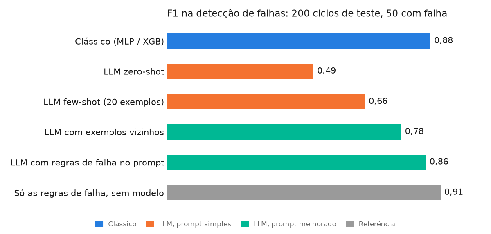

# Manutenção preditiva: modelos clássicos x LLM


**Um LLM consegue substituir um modelo treinado para prever falhas em máquinas industriais?**
Comparei SVM, MLP, Random Forest e XGBoost com o DeepSeek classificando por prompt, nos mesmos
dados, medindo desempenho, tempo e custo.

<<<<<<< HEAD
*English: classical ML vs. LLM prompting for predictive maintenance (AI4I 2020). Tuned classifiers
reach F1 0.88; the prompted LLM reaches 0.66, and 0.86 only when the failure rules are written into
the prompt. The same rules alone score 0.91.*
=======
>>>>>>> fe2d37fa4753bd65c8a480bb44d266b42f125fc5



## Principais resultados

- **Os modelos clássicos vencem com folga:** F1 de 0,88 contra 0,66 do LLM com prompt simples.
  Eles respondem em menos de 1 ms por previsão e sem custo; o LLM leva cerca de 1 s e cobra por
  chamada.
- **Engenharia de prompt reduz a distância:** exemplos escolhidos por vizinhança e limiar ajustado
  em validação levam o LLM de 0,66 a 0,78. Com as regras de falha da documentação no prompt, a 0,86.
- **Mas o ganho vem do conhecimento de domínio, não do LLM:** as mesmas regras, aplicadas direto e
  sem modelo nenhum, dão 0,91.
- **Onde o LLM ajuda:** sem nenhum dado de treino, o zero-shot já detecta 86% das falhas. Serve
  como triagem quando ainda não há histórico rotulado.

## O que o projeto mostra

- **Pipeline sem vazamento de dados:** colunas derivadas do alvo removidas; normalização e SMOTE
  ajustados só nos folds de treino.
- **Classes muito desbalanceadas** (3,4% de falhas), avaliadas por F1 e revocação, não por acurácia.
- **Busca de hiperparâmetros** com validação cruzada estratificada em quatro famílias de modelos.
- **LLM como classificador, medido com rigor:** prompts versionados, zero-shot e few-shot,
  exemplos por vizinhos mais próximos, ajuste de limiar em validação, cache de respostas, custo e
  latência por previsão.
- **Reprodutibilidade:** semente fixa, dependências travadas com uv, prompts e resultados versionados.

📄 [Relatório técnico (PDF)](reports/relatorio/relatorio.pdf) ·
📊 [Slides (PDF)](reports/slides/apresentacao.pdf) ·
📓 [Notebooks](notebooks/)

## Problema e dados

Uma parada não planejada numa linha de produção custa caro. A pergunta é: **dadas as leituras de
sensores de um ciclo de operação, a máquina vai falhar?** É uma classificação binária em que
deixar passar uma falha custa mais que um alarme falso.

- **Base:** [AI4I 2020 Predictive Maintenance](https://archive.ics.uci.edu/dataset/601) (UCI),
  10.000 ciclos de uma fresadora, 339 falhas
- **Atributos:** tipo do produto, temperaturas do ar e do processo, rotação, torque e desgaste da
  ferramenta

## Abordagem

| Etapa | O quê | Como |
|---|---|---|
| Dados | limpeza, divisão, normalização, balanceamento | split estratificado 80/20; z-score e SMOTE só no treino; remoção das colunas que vazam o alvo |
| I. Clássicos | SVM, MLP, Random Forest, XGBoost | busca em grade com validação cruzada estratificada de 5 folds, otimizando F1 |
| II. LLM | classificação por prompt | DeepSeek (`deepseek-chat`) zero-shot e few-shot com 3, 5, 10 e 20 exemplos |
| Extra | prompt melhorado | exemplos por vizinhança, atributos derivados, regras de falha no prompt, `deepseek-reasoner` |
| Comparação | mesmas métricas, mesmos dados | 200 casos fixos do teste (50 falhas); precisão, revocação, F1, AUC-ROC, tempo e custo |

## Resultados detalhados

### Clássicos x LLM

Amostra fixa de 200 casos do teste (50 falhas). Como ela tem 25% de falhas, a precisão aqui é
maior que no teste completo. Tabela completa em [`comparison.md`](reports/results/comparison.md).

| Modelo | Configuração | Precisão | Revocação | F1 | AUC-ROC | Tempo/100 | Custo/100 |
|---|---|---|---|---|---|---|---|
| MLP | SMOTE | 0,976 | 0,800 | 0,879 | 0,979 | < 0,01 s | — |
| XGBoost | SMOTE | 0,976 | 0,800 | 0,879 | 0,973 | < 0,01 s | — |
| SVM | SMOTE | 0,975 | 0,780 | 0,867 | 0,964 | 0,05 s | — |
| LLM (DeepSeek) | zero-shot | 0,341 | 0,860 | 0,489 | 0,721 | 98 s | US$ 0,005 |
| LLM (DeepSeek) | few-shot, k=20 | 0,597 | 0,740 | 0,661 | 0,843 | 97 s | US$ 0,024 |

### Etapa I no teste completo

2.000 casos, 68 falhas, configuração com SMOTE.

| Modelo | Precisão | Revocação | F1 | AUC-ROC | Melhor configuração |
|---|---|---|---|---|---|
| XGBoost | 0,714 | 0,809 | **0,759** | 0,970 | 500 árvores, profundidade 6, taxa 0,1 |
| MLP | 0,509 | 0,809 | 0,625 | 0,969 | camadas (64, 32), α = 0,01, taxa 0,01 |
| Random Forest | 0,495 | 0,735 | 0,592 | 0,973 | 200 árvores, sem limite de profundidade |
| SVM (RBF) | 0,402 | 0,779 | 0,530 | 0,951 | C = 100, γ = scale |

Atributos derivados (potência, diferença de temperatura, desgaste x torque) melhoram SVM, MLP e
Random Forest, que vai a 0,718. Pesos de classe no lugar do SMOTE melhoram Random Forest e
XGBoost (0,692 e 0,768) e pioram SVM e MLP.

### Experimento extra: prompt melhorado

Tabela em [`comparison_extra.md`](reports/results/extra/comparison_extra.md), gráfico em
[`extra_f1.png`](reports/figures/extra_f1.png).

| Variante | F1 | Observação |
|---|---|---|
| 10 exemplos vizinhos + limiar ajustado | 0,782 | só dados de treino |
| regras de falha + vizinhos + limiar (`deepseek-chat`) | 0,844 | usa conhecimento de domínio |
| regras de falha, zero-shot (`deepseek-reasoner`) | 0,864 | ~5x mais lento, 7 respostas inválidas em 200 |
| só as regras, sem LLM | 0,913 | referência |

## Como rodar

Ambiente gerenciado com [uv](https://docs.astral.sh/uv/):

```bash
uv sync                                  # Python 3.12 e dependências travadas no uv.lock

uv run python -m src.data                # conjuntos de treino, teste e amostra fixa
uv run python -m src.train_classical     # Etapa I
cp .env.example .env                     # Etapa II: coloque a DEEPSEEK_API_KEY no .env
uv run python -m src.run_llm --dry-run   # mostra o prompt sem chamar a API
uv run python -m src.run_llm             # zero-shot e few-shot 3/5/10/20
uv run python -m src.run_llm_extra       # experimento extra
uv run python -m src.compare             # tabela e figuras finais

uv run jupyter lab                       # notebooks
```

Com `LLM_PROVIDER=dummy` a Etapa II roda offline e sem custo, para testar o pipeline.
Sem uv: `pip install -r requirements.txt`.

## Estrutura

```
├── data/raw/ai4i2020.csv        base original
├── notebooks/                   EDA, Etapa I, Etapa II e comparação
├── src/
│   ├── data.py                  carga, limpeza, split e amostra fixa
│   ├── train_classical.py       Etapa I
│   ├── run_llm.py               Etapa II
│   ├── run_llm_extra.py         experimento extra
│   ├── compare.py               comparação final
│   ├── metrics.py, config.py
│   └── llm/                     prompts v1 e v2, clientes de LLM
└── reports/
    ├── relatorio/               relatório (LaTeX e PDF, modelo SBC)
    ├── slides/                  apresentação
    ├── figures/                 matrizes de confusão, ROC, comparações
    └── results/                 métricas, predições e prompts usados
```

## Decisões de projeto

- **Sem vazamento:** TWF, HDF, PWF, OSF e RNF indicam o *tipo* de falha e só existem quando há
  falha, então saem dos atributos.
- **F1 e revocação, não acurácia:** um modelo que responde sempre "normal" já tem 96,6% de acurácia.
- **Amostra fixa enriquecida:** rodar o LLM nos 2.000 casos de teste por configuração seria caro e
  lento. A comparação usa 200 casos fixos com 25% de falhas, para a revocação ser mensurável; os
  clássicos também são avaliados no teste completo.
- **Comparação justa:** o prompt principal não recebe nenhuma informação que os modelos clássicos
  não tenham. O que usa conhecimento de domínio fica separado no experimento extra.

## Referências

- S. Matzka. *Explainable Artificial Intelligence for Predictive Maintenance Applications.* AI4I 2020.
- T. Brown et al. *Language Models are Few-Shot Learners.* NeurIPS 2020.
- S. Hegselmann et al. *TabLLM: Few-shot Classification of Tabular Data with Large Language Models.* AISTATS 2023.

## Autor

**Vitor Reis** · Sistemas de Informação, UFJF · [GitHub](https://github.com/vitorszreis)

Trabalho final da disciplina DCC068 Redes Neurais Artificiais (2026/2).
