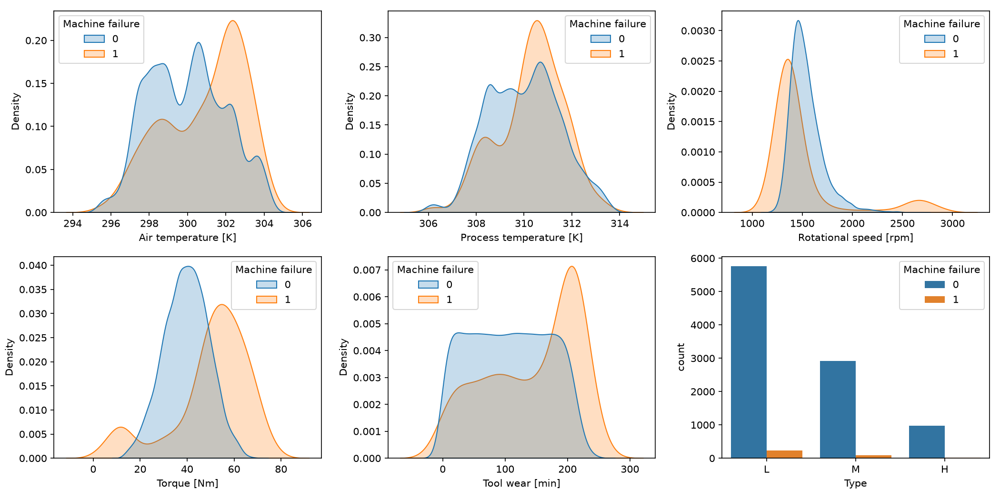
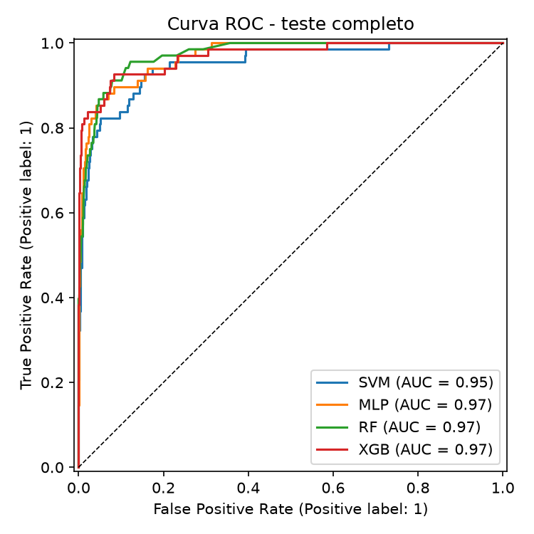
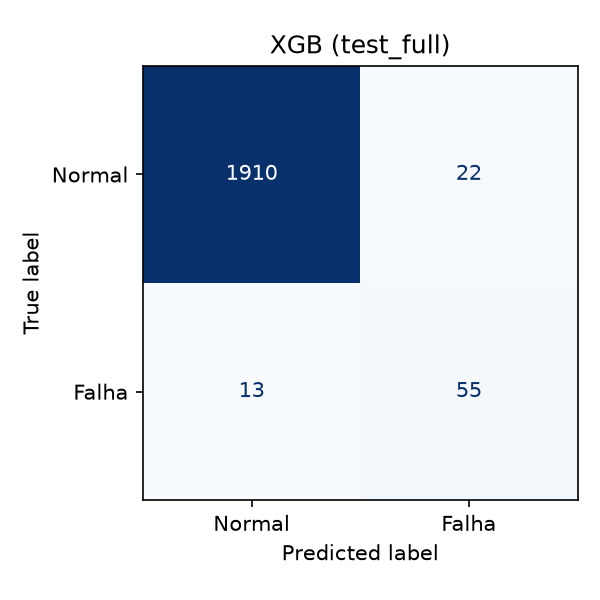
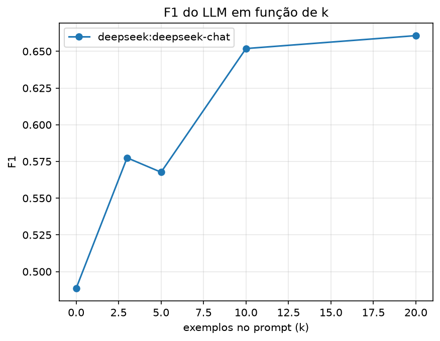
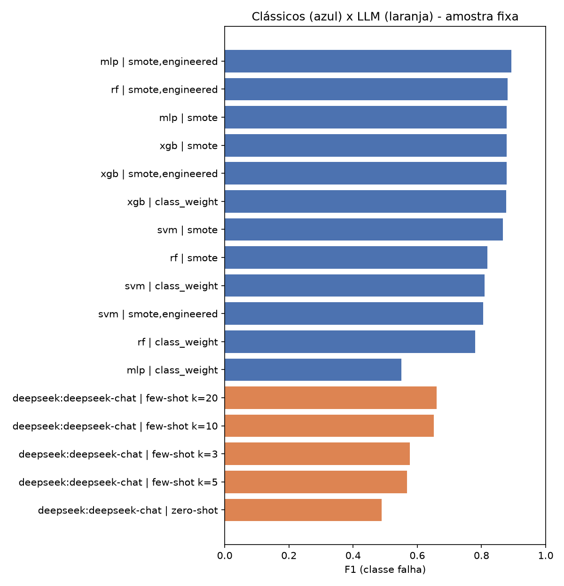
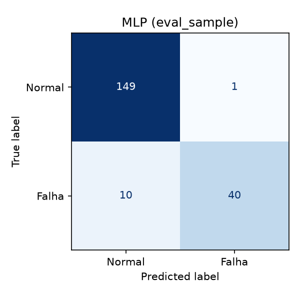
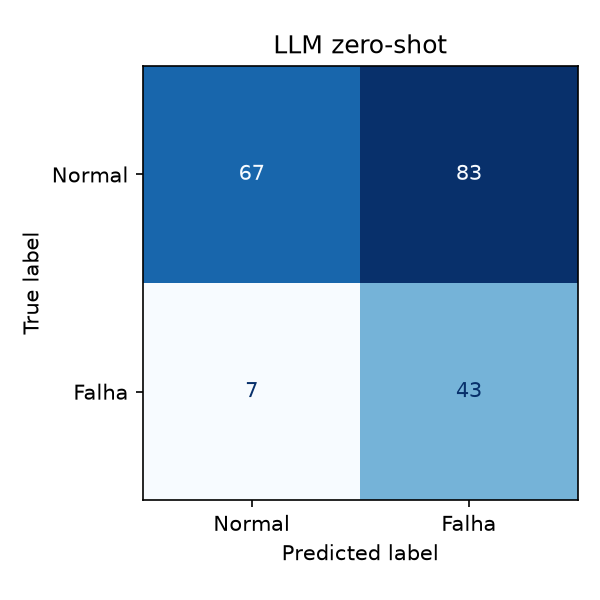
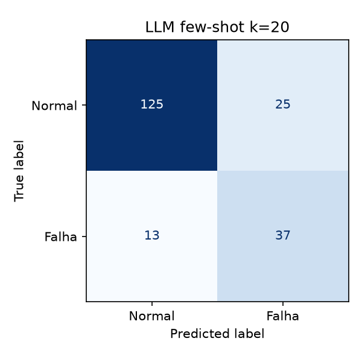

# Manutenção preditiva com modelos clássicos e LLM: um estudo comparativo na base AI4I 2020

**Disciplina:** DCC068 Redes Neurais Artificiais (UFJF, 2026/2)
**Autor:** Vitor Reis, Departamento de Ciência da Computação (DCC), Universidade Federal de Juiz de Fora (UFJF)
**Data:** __/12/2026

> Versão em Markdown do relatório técnico. A versão formatada no modelo da SBC está em
> [`relatorio/relatorio.pdf`](relatorio/relatorio.pdf) (fonte em `relatorio/relatorio.tex`).

## Resumo

Este relatório compara modelos clássicos de aprendizado de máquina com um modelo de linguagem de grande porte (LLM) usado via *prompting* na previsão binária de falhas de máquinas da base AI4I 2020, que reúne 10.000 ciclos de uma fresadora dos quais apenas 3,4% terminam em falha. Na primeira etapa, SVM, MLP, Random Forest e XGBoost foram treinados em um *pipeline* sem vazamento de informação, com padronização e SMOTE, e ajustados por busca em grade com validação cruzada estratificada de 5 *folds*. Na segunda etapa, o modelo `deepseek-chat`, acessado pela API da DeepSeek, classificou a mesma amostra fixa de 200 casos de teste em modo *zero-shot* e com 3, 5, 10 e 20 exemplos rotulados. Nessa amostra, os modelos clássicos atingiram F1 entre 0,82 e 0,88 e AUC-ROC entre 0,96 e 0,98, ao passo que o LLM passou de F1 0,49 (*zero-shot*) para 0,66 (20 exemplos), sempre com revocação alta, porém com muitos alarmes falsos, cerca de 96 s por 100 amostras e custo estimado de US$ 0,12 para as 1.000 consultas. Conclui-se que, havendo dados rotulados, os modelos clássicos vencem com folga, enquanto o LLM serve sobretudo como triagem inicial quando não há dados de treino.

## 1. Introdução

Em uma linha de produção, a parada não planejada de uma máquina interrompe a fabricação, atrasa entregas e, muitas vezes, danifica peças e ferramentas. Por esse motivo, a manutenção preditiva procura antecipar a falha a partir das leituras de sensores, de modo que a intervenção aconteça antes da quebra e não depois dela. Do ponto de vista de aprendizado de máquina, trata-se de um problema de classificação binária fortemente desbalanceado, já que a imensa maioria dos ciclos de operação termina sem falha e, ainda assim, deixar passar uma falha costuma custar muito mais do que emitir um alarme falso.

Tradicionalmente, esse tipo de problema é resolvido com modelos supervisionados treinados sobre milhares de exemplos rotulados, como máquinas de vetores de suporte (SVM), redes neurais do tipo perceptron multicamadas (MLP) e conjuntos de árvores de decisão. Mais recentemente, entretanto, os modelos de linguagem de grande porte (LLMs) passaram a ser usados como classificadores genéricos, bastando descrever a tarefa em linguagem natural e, opcionalmente, mostrar alguns exemplos no próprio *prompt* [Brown et al. 2020; Hegselmann et al. 2023]. Essa possibilidade é atraente porque dispensa treino, mas não é óbvio que ela se sustente em dados tabulares numéricos, nos quais a decisão depende de limiares e de interações entre grandezas físicas.

Diante disso, o objetivo deste trabalho é medir o ganho ou a perda de usar um LLM via *prompting* em vez de modelos clássicos, na mesma tarefa e sobre os mesmos dados. Para tanto, a Seção 2 apresenta o problema e a base de dados; em seguida, a Seção 3 descreve a metodologia de preparação, balanceamento, divisão e avaliação; as Seções 4 e 5 relatam, respectivamente, os resultados dos modelos clássicos e do LLM; a Seção 6 faz a comparação crítica entre as duas abordagens; e, por fim, a Seção 7 reúne as conclusões, as limitações e os próximos passos.

## 2. Problema e base de dados

- **Tipo de problema:** classificação binária
- **Base:** AI4I 2020 Predictive Maintenance (UCI), 10.000 amostras, 6 atributos de entrada
- **Valor desejado:** `Machine failure` (0 = normal, 1 = falha), 339 falhas (3,39%)

A base escolhida foi a AI4I 2020 *Predictive Maintenance Dataset*, disponibilizada no repositório da UCI [Matzka 2020b] e descrita em [Matzka 2020a]. Embora sintética, ela foi construída para reproduzir o comportamento de uma fresadora real e contém 10.000 ciclos de operação, cada um descrito por seis atributos de entrada: o tipo do produto em fabricação (L, M ou H, isto é, qualidade baixa, média ou alta, presentes em cerca de 60%, 30% e 10% dos ciclos), a temperatura do ar e a temperatura do processo, ambas em kelvin, a velocidade de rotação em rpm, o torque em N·m e o desgaste acumulado da ferramenta em minutos. O valor desejado é o atributo *Machine failure*, que vale 1 quando o ciclo termina em falha e 0 caso contrário; ao todo, há apenas 339 falhas, ou seja, 3,39% das amostras. Consequentemente, um classificador trivial que sempre respondesse "normal" acertaria 96,6% dos casos sem detectar falha alguma, o que já indica que a acurácia, sozinha, não é uma boa métrica para este problema.

A Tabela 1 mostra três exemplos reais da base. Enquanto as duas primeiras linhas são ciclos normais, a terceira é uma falha de potência, caracterizada por uma rotação muito alta combinada com um torque muito baixo, de modo que a potência mecânica resultante sai da faixa de operação segura.

**Tabela 1.** Exemplos da base AI4I 2020 (identificadores UDI 1, 2 e 51)

| UDI | Tipo | T. ar [K] | T. processo [K] | Rotação [rpm] | Torque [N·m] | Desgaste [min] | Falha |
|---|---|---|---|---|---|---|---|
| 1 | M | 298,1 | 308,6 | 1551 | 42,8 | 0 | 0 |
| 2 | L | 298,2 | 308,7 | 1408 | 46,3 | 3 | 0 |
| 51 | L | 298,9 | 309,1 | 2861 | 4,6 | 143 | 1 |



**Figura 1.** Distribuição dos atributos de entrada por classe (normal e falha), gerada em `notebooks/01_eda_preparacao.ipynb`.

Além desses atributos, a base traz cinco colunas que indicam o modo da falha ocorrida: desgaste da ferramenta (TWF), dissipação de calor (HDF), potência (PWF), sobrecarga (OSF) e falha aleatória (RNF). Essas colunas, contudo, são derivadas do próprio alvo, pois só valem 1 quando a falha já aconteceu; assim, usá-las como entrada entregaria a resposta ao modelo, caracterizando vazamento de informação (*data leakage*). Por essa razão, elas foram removidas da entrada e mantidas apenas para a análise dos erros. Vale notar, ainda, que a base contém um pequeno ruído de rotulação conhecido, com 9 falhas sem modo marcado e 18 ciclos com modo marcado mas sem falha, o qual foi preservado para não alterar a distribuição original.

## 3. Metodologia

### 3.1 Preparação e limpeza

Inicialmente, verificou-se a ausência de valores nulos e de registros duplicados, o que confirmou que a base vem limpa. Em seguida, foram descartados os identificadores *UDI* e *Product ID*, que não carregam informação física, e as cinco colunas de modo de falha, pelos motivos expostos na seção anterior. O atributo categórico *Type* foi codificado por *one-hot*, enquanto os cinco atributos numéricos foram padronizados por *z-score*. É importante destacar que a padronização não foi ajustada na base inteira, e sim dentro do *pipeline* de cada modelo, de forma que média e desvio padrão são estimados apenas com os dados de treino de cada *fold* e depois aplicados aos dados de validação ou de teste. Optou-se, por fim, por não incluir atributos derivados (como a diferença de temperatura ou a potência), de modo que tanto os modelos clássicos quanto o LLM recebessem exatamente as mesmas seis grandezas brutas.

### 3.2 Balanceamento de classes

Para lidar com o desbalanceamento, utilizou-se a técnica SMOTE [Chawla et al. 2002], que gera exemplos sintéticos da classe minoritária por interpolação entre vizinhos próximos. Da mesma forma que a padronização, o SMOTE foi colocado dentro do *pipeline* da biblioteca *imbalanced-learn* [Lemaître et al. 2017], logo após o pré-processamento e antes do classificador. Desse modo, as falhas sintéticas são criadas somente nos *folds* de treino durante a validação cruzada e nunca contaminam os dados de validação ou de teste, o que evitaria uma estimativa otimista de desempenho.

### 3.3 Divisão dos conjuntos

A base foi dividida em 80% para treino e 20% para teste, de maneira estratificada pelo alvo e com semente fixa igual a 42, o que resultou em 8.000 ciclos de treino, com 271 falhas, e 2.000 ciclos de teste, com 68 falhas. O conjunto de teste não participou de nenhuma decisão de modelagem, já que a escolha de hiperparâmetros foi feita exclusivamente por validação cruzada estratificada de 5 *folds* dentro do treino.

Como cada consulta ao LLM leva cerca de um segundo e tem custo, avaliar o LLM nos 2.000 casos de teste em cinco configurações seria caro e demorado. Por outro lado, uma subamostra estratificada de 200 casos conteria apenas cerca de 7 falhas, número pequeno demais para estimar a revocação com alguma confiança. Por isso, foi sorteada do conjunto de teste uma amostra fixa de 200 casos enriquecida com falhas, composta por 50 falhas e 150 ciclos normais (25% de falhas). Essa amostra foi avaliada por todos os modelos, clássicos e LLM, o que garante que a comparação use exatamente os mesmos dados, conforme exige o enunciado. Ainda assim, como o enriquecimento infla a precisão de todos os classificadores em relação à taxa real de falhas, os modelos clássicos também foram avaliados no teste completo, e esse efeito é discutido explicitamente na Seção 6.

### 3.4 Métricas de avaliação

Seguindo o enunciado, foram calculadas acurácia, precisão, revocação, F1, AUC-ROC e matriz de confusão, sempre considerando a falha como classe positiva. Nesse contexto, a revocação indica quantas das falhas reais o modelo detectou, ao passo que a precisão indica quantos dos alarmes emitidos correspondiam de fato a falhas. Como a acurácia é dominada pela classe majoritária, adotou-se o F1 da classe falha, que equilibra precisão e revocação, como métrica principal, tanto para escolher hiperparâmetros quanto para comparar os modelos. Na Etapa II, além dessas métricas, foram medidos o tempo de inferência por 100 amostras, a quantidade de tokens consumidos e o custo estimado da API.

## 4. Etapa I: algoritmos clássicos

### 4.1 Modelos e hiperparâmetros

Dentre os modelos sugeridos para classificação, foram escolhidos a SVM com *kernel* RBF [Cortes e Vapnik 1995] e a MLP [Haykin 2009], que correspondem ao conteúdo central da disciplina, e, como referência, o Random Forest [Breiman 2001] e o XGBoost [Chen e Guestrin 2016], que costumam ser fortes em dados tabulares. Todos foram implementados com *scikit-learn* [Pedregosa et al. 2011] e ajustados por busca em grade (*GridSearchCV*) com validação cruzada estratificada de 5 *folds*, otimizando o F1. A Tabela 2 resume a grade testada e a melhor configuração encontrada para cada modelo, juntamente com o F1 médio na validação cruzada e o tempo total da busca em grade. A MLP foi treinada com até 500 épocas e parada antecipada (*early stopping*).

**Tabela 2.** Grade de hiperparâmetros, melhor configuração e F1 médio na validação cruzada (5 *folds*)

| Modelo | Grade testada | Melhor configuração | F1 (CV) | Tempo da busca [s] |
|---|---|---|---|---|
| SVM (RBF) | C ∈ {0,1; 1; 10; 100}, γ ∈ {scale; 0,1; 0,01} | C = 100, γ = scale | 0,542 | 186,8 |
| MLP | camadas ∈ {(16), (32), (32,16), (64,32)}, α ∈ {10⁻⁴, 10⁻³, 10⁻²}, taxa ∈ {10⁻³, 10⁻²} | camadas (64,32), α = 10⁻², taxa 10⁻² | 0,594 | 81,2 |
| Random Forest | árvores ∈ {200, 500}, profundidade ∈ {livre, 10, 20} | 200 árvores, profundidade livre | 0,631 | 18,5 |
| XGBoost | árvores ∈ {200, 500}, profundidade ∈ {3, 6}, taxa ∈ {0,05; 0,1} | 500 árvores, profundidade 6, taxa 0,1 | 0,689 | 8,4 |

### 4.2 Resultados

A Tabela 3 apresenta o desempenho dos quatro modelos no conjunto de teste completo, com 2.000 ciclos e 68 falhas. Observa-se, em primeiro lugar, que todos os modelos detectam entre 74% e 81% das falhas e mantêm AUC-ROC entre 0,95 e 0,97, o que mostra que eles separam bem as duas classes quando se considera todo o intervalo de limiares (Figura 2). Entretanto, eles se diferenciam bastante na quantidade de alarmes falsos: enquanto o XGBoost emite apenas 22 alarmes falsos e alcança o melhor F1 (0,76), a MLP fica em segundo lugar (F1 0,63, com 53 alarmes falsos) e a SVM, com 79 alarmes falsos, obtém o menor F1 (0,53). Esse resultado é coerente com a natureza da base, cujas falhas são geradas por regras de limiar sobre grandezas físicas, um tipo de fronteira que os conjuntos de árvores aproximam com facilidade.

**Tabela 3.** Etapa I no conjunto de teste completo (2.000 ciclos, 68 falhas). VN, FP, FN e VP são os elementos da matriz de confusão.

| Modelo | Acurácia | Precisão | Revocação | F1 | AUC-ROC | VN | FP | FN | VP |
|---|---|---|---|---|---|---|---|---|---|
| SVM | 0,953 | 0,402 | 0,779 | 0,530 | 0,951 | 1853 | 79 | 15 | 53 |
| MLP | 0,967 | 0,509 | 0,809 | 0,625 | 0,969 | 1879 | 53 | 13 | 55 |
| Random Forest | 0,966 | 0,495 | 0,735 | 0,592 | 0,973 | 1881 | 51 | 18 | 50 |
| XGBoost | **0,983** | **0,714** | **0,809** | **0,759** | 0,970 | 1910 | 22 | 13 | 55 |



**Figura 2.** Curvas ROC dos modelos clássicos no conjunto de teste completo.



**Figura 3.** Matriz de confusão do XGBoost, melhor modelo, no conjunto de teste completo.

Já na amostra fixa de 200 casos, cujos resultados aparecem na Tabela 5 da Seção 6, os números são bem mais altos: a MLP e o XGBoost empatam com F1 de 0,88, seguidos pela SVM (0,87) e pelo Random Forest (0,82). Essa diferença não se deve a um desempenho melhor dos modelos, e sim ao enriquecimento da amostra, pois, com 25% de falhas em vez de 3,4%, há muito menos ciclos normais que possam virar alarme falso, de modo que a precisão e, por consequência, o F1 aumentam. Por isso, os valores da amostra fixa servem para comparar modelos entre si sob as mesmas condições, mas não devem ser lidos como o desempenho esperado em operação.

### 4.3 Experimentos complementares

Além da configuração principal, foram executadas duas variações dos modelos clássicos, cujos resultados estão em `reports/results/summary.csv`. Na primeira, o SMOTE foi substituído por pesos de classe (`class_weight`), ou seja, em vez de criar falhas sintéticas, o erro em uma falha passa a pesar mais na função de custo; na segunda, mantido o SMOTE, foram acrescentados três atributos derivados (*engineered*, em `src/data.py`) ligados às regras de falha da documentação da base: a diferença entre as temperaturas do processo e do ar (dissipação de calor), a potência em watts, isto é, torque vezes velocidade angular (falha de potência), e o produto entre desgaste e torque (sobrecarga). Como o `MLPClassifier` do *scikit-learn* não aceita pesos de classe, na variação com pesos a MLP foi treinada sem nenhum balanceamento. A Tabela 4a resume o F1 e a AUC-ROC no teste completo.

**Tabela 4a.** F1 / AUC-ROC no conjunto de teste completo (2.000 ciclos, 68 falhas) para cada estratégia

| Modelo | SMOTE (principal) | Pesos de classe | SMOTE + atributos derivados |
|---|---|---|---|
| SVM | 0,530 / 0,951 | 0,493 / 0,955 | 0,559 / 0,958 |
| MLP | 0,625 / 0,969 | 0,596 / 0,974 | 0,640 / 0,971 |
| Random Forest | 0,592 / 0,973 | 0,692 / 0,964 | 0,718 / 0,969 |
| XGBoost | 0,759 / 0,970 | **0,768** / 0,970 | 0,748 / **0,985** |

De modo geral, os atributos derivados ajudam a SVM, a MLP e sobretudo o Random Forest, cujo F1 sobe de 0,59 para 0,72, o que confirma que as regras da base dependem dessas grandezas. Os pesos de classe, por sua vez, favorecem os conjuntos de árvores, ao passo que a MLP, treinada nessa variação sem balanceamento algum, fica conservadora demais: ela passa a emitir apenas 5 alarmes falsos no teste completo, porém detecta somente 31 das 68 falhas (revocação 0,46). Como essas variações não alteram a conclusão principal e o enunciado pede que os dois estágios usem os mesmos dados, a comparação com o LLM nas seções seguintes usa a configuração principal, com SMOTE e as seis grandezas brutas.

## 5. Etapa II: LLM via prompting

### 5.1 Modelo e configuração

- **Provedor / modelo / versão:** DeepSeek API, `deepseek-chat` (apelido que, segundo o histórico de mudanças da DeepSeek, aponta desde abril de 2026 para `deepseek-v4-flash` sem raciocínio estendido; inferido da documentação, não registrado na execução)
- **Data da execução:** consultas em 22/11/2026; métricas regeneradas a partir do cache das respostas em 26/11/2026, sem novas chamadas
- **Parâmetros:** temperatura 0, no máximo 200 tokens de saída (`LLM_MAX_TOKENS`), uma consulta por vez, versão do *prompt* v1 (`src/llm/prompts.py`)
- **Preço usado na estimativa (USD por 1M tokens):** entrada 0,15 (sem acerto de cache) / saída 0,60, tarifa fora do pico; no pico os valores dobram

Na segunda etapa, utilizou-se o modelo `deepseek-chat` por meio da API da DeepSeek [DeepSeek 2026], com temperatura zero e no máximo 200 tokens de saída. As consultas foram feitas em 22/11/2026, uma por vez, e as métricas foram regeneradas a partir do cache das respostas em 26/11/2026, sem novas chamadas à API. Cabe ressaltar que `deepseek-chat` é um apelido (*alias*) cuja versão subjacente muda ao longo do tempo. De acordo com o histórico de mudanças da DeepSeek, desde abril de 2026 esse apelido aponta para o modelo `deepseek-v4-flash` em modo sem raciocínio estendido; contudo, como a API não registrou a versão exata em cada resposta, essa correspondência é uma inferência a partir da documentação, e não uma informação verificada na execução.

### 5.2 Prompt

O *prompt* (versão v1) foi escrito em português e dividido em uma mensagem de sistema e uma mensagem de usuário. A mensagem de sistema atribui ao modelo o papel de engenheiro de manutenção especialista em fresadoras, descreve a tarefa de classificar se a máquina vai falhar (1) ou não (0), explica o significado de cada atributo e exige como resposta somente um JSON de uma linha no formato `{"falha": 0 ou 1, "probabilidade": p}`. A probabilidade foi pedida justamente para permitir o cálculo da AUC-ROC, que exige uma pontuação contínua e não apenas o rótulo. A mensagem de usuário, por sua vez, traz a leitura a ser classificada em formato textual, como no exemplo abaixo, que corresponde à configuração com 3 exemplos:

```text
Exemplos rotulados (3):
- Tipo: L | Temperatura do ar: 302.4 K | Temperatura do processo:
  310.3 K | Rotação: 1374 rpm | Torque: 51.2 Nm | Desgaste da
  ferramenta: 163 min -> {"falha": 1}
- (... mais 2 exemplos ...)
Classifique esta leitura:
Tipo: M | Temperatura do ar: 299.0 K | Temperatura do processo:
310.3 K | Rotação: 1657 rpm | Torque: 31.0 Nm | Desgaste da
ferramenta: 70 min
```

No modo *zero-shot*, a lista de exemplos é simplesmente omitida, enquanto nos modos *few-shot* ela contém k ∈ {3, 5, 10, 20} exemplos sorteados do conjunto de treino, metade deles falhas (no mínimo uma), já que na proporção real de 3,4% quase nunca apareceria uma falha entre os exemplos. Além disso, os conjuntos de exemplos são aninhados (3 ⊂ 5 ⊂ 10 ⊂ 20), de forma que a diferença entre duas configurações se deve apenas aos exemplos acrescentados, e não a um novo sorteio. Os *prompts* completos de cada configuração foram salvos junto com os resultados (`reports/results/prompts/`) para garantir a reprodutibilidade.

### 5.3 Resultados

A Tabela 4 e a Figura 4 resumem o desempenho do LLM na amostra fixa. Em todas as 1.000 consultas (200 casos em cinco configurações) o modelo respondeu com um JSON válido, de modo que não houve nenhuma resposta inválida a descartar. Observa-se, de saída, que o LLM é alarmista: no modo *zero-shot*, ele detecta 86% das falhas, mas marca como falha 83 dos 150 ciclos normais, o que resulta em precisão de apenas 0,34 e F1 de 0,49.

**Tabela 4.** Etapa II na amostra fixa (200 casos, 50 falhas). Tokens de entrada por consulta e custo estimado por 100 amostras com a tarifa fora do pico.

| Configuração | Acurácia | Precisão | Revocação | F1 | AUC-ROC | FP | FN | Respostas inválidas | Tokens/consulta | Tempo/100 [s] | Custo/100 [US$] |
|---|---|---|---|---|---|---|---|---|---|---|---|
| Zero-shot | 0,550 | 0,341 | 0,860 | 0,489 | 0,721 | 83 | 7 | 0 | 272 | 97,7 | 0,0050 |
| Few-shot k=3 | 0,700 | 0,446 | 0,820 | 0,578 | 0,803 | 51 | 9 | 0 | 472 | 95,3 | 0,0080 |
| Few-shot k=5 | 0,665 | 0,419 | 0,880 | 0,568 | 0,802 | 61 | 6 | 0 | 600 | 97,9 | 0,0100 |
| Few-shot k=10 | 0,765 | 0,518 | 0,880 | 0,652 | **0,850** | 41 | 6 | 0 | 920 | 95,0 | 0,0148 |
| Few-shot k=20 | **0,810** | **0,597** | 0,740 | **0,661** | 0,843 | 25 | 13 | 0 | 1.560 | 96,6 | 0,0244 |



**Figura 4.** F1 do LLM na amostra fixa em função do número de exemplos k no *prompt* (k = 0 é o *zero-shot*).

À medida que exemplos são acrescentados ao *prompt*, porém, o comportamento melhora de forma visível, sobretudo na precisão. De fato, os alarmes falsos caem de 83 no *zero-shot* para 41 com 10 exemplos e para 25 com 20 exemplos, de modo que o F1 sobe de 0,49 para 0,65 e 0,66, respectivamente. Ainda assim, essa evolução não é monótona, já que a configuração com 5 exemplos fica ligeiramente abaixo da configuração com 3, e o ganho entre 10 e 20 exemplos é praticamente nulo. Uma explicação plausível é que os conjuntos pequenos não mostram ao modelo a variedade das falhas: com 3 exemplos há apenas uma falha, e com 5 há duas, todas do tipo dissipação de calor, de modo que somente a partir de 10 exemplos aparecem falhas de desgaste, potência e sobrecarga. Além disso, com 20 exemplos a revocação recua de 0,88 para 0,74, o que sugere que os exemplos normais com desgaste alto "ensinaram" ao modelo que desgaste alto, por si só, não basta para prever uma falha; em particular, as falhas por desgaste da ferramenta, que eram todas detectadas no *zero-shot* (7 de 7), passam a ser detectadas em apenas 2 de 7 casos.

Quanto ao tempo, cada consulta levou em média 0,97 s, o que corresponde a cerca de 96 s por 100 amostras, praticamente constante entre as configurações, uma vez que a latência é dominada pela ida e volta à API e as chamadas foram feitas em sequência. Em contrapartida, a quantidade de tokens de entrada cresce com k, passando de 272 por consulta no *zero-shot* para 1.560 com 20 exemplos, enquanto a saída fica fixa em 16 tokens. No total, as 1.000 consultas consumiram 764.800 tokens de entrada e 16.000 tokens de saída.

Para estimar o custo, foram usados os preços públicos da DeepSeek consultados em 24/11/2026 para o modelo `deepseek-v4-flash`, que, como discutido acima, é provavelmente o modelo por trás do apelido `deepseek-chat`. Na tarifa fora do horário de pico, válida no domingo em que as consultas foram feitas, o preço é de US$ 0,15 por milhão de tokens de entrada (sem acerto de cache) e US$ 0,60 por milhão de tokens de saída, valores que dobram no horário de pico. Assim, o custo estimado vai de US$ 0,005 por 100 amostras no *zero-shot* a US$ 0,024 por 100 amostras com 20 exemplos, e o custo total da Etapa II fica em torno de US$ 0,12, ou de US$ 0,25 caso todas as consultas tivessem sido feitas no pico. Note-se que o ganho de 10 para 20 exemplos custa 70% mais tokens sem melhora mensurável do F1.

## 6. Comparação crítica

A Tabela 5 e a Figura 5 colocam lado a lado os modelos clássicos e o LLM na mesma amostra fixa. Fica claro, antes de tudo, que mesmo a melhor configuração do LLM (F1 0,66 com 20 exemplos) fica muito abaixo do pior modelo clássico (F1 0,82 do Random Forest) e mais de 0,2 abaixo da MLP e do XGBoost (0,88). Essa diferença, ademais, não é fruto do acaso: por *bootstrap* sobre os 200 casos, o intervalo de confiança de 95% para a diferença de F1 entre a MLP e o LLM com 20 exemplos vai de 0,11 a 0,33. O mesmo ocorre com a AUC-ROC, que fica entre 0,96 e 0,98 para os clássicos e não passa de 0,85 no LLM.

**Tabela 5.** Modelos clássicos e LLM na mesma amostra fixa (200 casos, 50 falhas). O tempo dos clássicos é apenas de inferência, com os modelos já treinados.

| Etapa | Modelo / configuração | Acurácia | Precisão | Revocação | F1 | AUC-ROC | Tempo/100 [s] |
|---|---|---|---|---|---|---|---|
| I | MLP | 0,945 | 0,976 | 0,800 | 0,879 | 0,979 | 0,002 |
| I | XGBoost | 0,945 | 0,976 | 0,800 | 0,879 | 0,973 | 0,003 |
| I | SVM | 0,940 | 0,975 | 0,780 | 0,867 | 0,964 | 0,050 |
| I | Random Forest | 0,920 | 0,947 | 0,720 | 0,818 | 0,979 | 0,039 |
| II | DeepSeek, k=20 | 0,810 | 0,597 | 0,740 | 0,661 | 0,843 | 96,6 |
| II | DeepSeek, k=10 | 0,765 | 0,518 | 0,880 | 0,652 | 0,850 | 95,0 |
| II | DeepSeek, k=3 | 0,700 | 0,446 | 0,820 | 0,578 | 0,803 | 95,3 |
| II | DeepSeek, k=5 | 0,665 | 0,419 | 0,880 | 0,568 | 0,802 | 97,9 |
| II | DeepSeek, zero-shot | 0,550 | 0,341 | 0,860 | 0,489 | 0,721 | 97,7 |



**Figura 5.** F1 da classe falha na amostra fixa: modelos clássicos (azul) e LLM (laranja).

As matrizes de confusão da Figura 6 ajudam a entender onde cada abordagem erra. Enquanto a MLP quase não emite alarmes falsos (apenas 1 em 150 ciclos normais) e perde 10 falhas, o LLM com 20 exemplos emite 25 alarmes falsos e, ainda assim, perde 13 falhas. Analisando as respostas, nota-se que os falsos positivos do LLM têm desgaste da ferramenta muito maior que os verdadeiros negativos (em média, 153 contra 47 minutos no *zero-shot*), além de torque um pouco maior e rotação um pouco menor. Em outras palavras, o LLM aplica uma regra de senso comum, segundo a qual ferramenta gasta e torque alto indicam falha iminente, que acerta muitas falhas, mas dispara em praticamente qualquer máquina desgastada. As regras reais da base, por outro lado, dependem de grandezas derivadas, como a diferença entre as temperaturas, a potência (torque vezes rotação) e o produto entre desgaste e torque, as quais o LLM teria de calcular sozinho a partir dos valores brutos. Curiosamente, os dois tipos de modelo erram em lugares diferentes: os clássicos também têm dificuldade com as falhas por desgaste, que na base ocorrem em um intervalo de desgaste quase aleatório, e o LLM em *zero-shot* detecta 9 das 10 falhas que a MLP deixa passar, o que sugere alguma complementaridade, ainda que ao custo de dezenas de alarmes falsos.

| (a) MLP | (b) LLM zero-shot | (c) LLM, k=20 |
|---|---|---|
|  |  |  |

**Figura 6.** Matrizes de confusão na amostra fixa (linhas: classe real; colunas: classe prevista).

Outro ponto que merece atenção é a qualidade das probabilidades retornadas pelo LLM. Embora o formato JSON tenha sido seguido à risca, as probabilidades são grosseiras e pouco calibradas, com apenas 9 a 13 valores distintos por configuração (no *zero-shot*, por exemplo, 94 casos receberam 0,82 e 39 receberam 0,12), o que limita a AUC-ROC. Além disso, com 20 exemplos o rótulo e a probabilidade passaram a se contradizer em 58 dos 200 casos, nos quais o modelo respondeu `"falha": 0` com probabilidade igual ou superior a 0,5. Somado a isso, apenas 58,5% dos casos receberam a mesma resposta nas cinco configurações, o que evidencia uma sensibilidade considerável ao conteúdo do *prompt*.

Por fim, a comparação se torna ainda mais desfavorável ao LLM quando se considera a taxa real de falhas. Como a amostra fixa tem 25% de falhas, ao passo que na base elas são 3,4%, é possível reestimar a precisão esperada em operação a partir da revocação e da taxa de alarmes falsos medidas na amostra [Saito e Rehmsmeier 2015]. Fazendo essa conta, a precisão esperada do LLM fica em torno de 0,05 no *zero-shot* e de 0,14 com 20 exemplos, o que significa que, no melhor caso, de cada sete alarmes seis seriam falsos. Para a MLP, a mesma conta resulta em 0,81; no entanto, como essa estimativa se apoia em um único alarme falso na amostra, ela é otimista, e a precisão efetivamente medida no teste completo, com a taxa real de falhas, é de 0,51. Mesmo assim, a vantagem dos modelos clássicos continua grande.

Em resumo, os modelos clássicos têm a seu favor um desempenho muito superior, respostas em milissegundos e sem custo por previsão, além de rodarem localmente, o que mantém os dados dentro da empresa. Em contrapartida, eles exigem milhares de exemplos rotulados, bem como preparação, balanceamento e ajuste de hiperparâmetros. O LLM, por sua vez, funciona sem treino algum e com no máximo 20 exemplos, aceita a descrição da tarefa em linguagem natural e melhora de maneira perceptível com poucos exemplos; por outro lado, seu F1 não passa de 0,66, ele gera alarmes falsos demais, cada consulta leva cerca de um segundo e tem custo, os dados precisam ser enviados a uma API externa e o modelo por trás do apelido pode mudar sem aviso.

## 7. Conclusões

Os resultados mostram que, quando há dados rotulados disponíveis, os modelos clássicos vencem o LLM com folga nesta tarefa. Na mesma amostra de 200 casos, a MLP e o XGBoost atingiram F1 de 0,88 contra 0,66 da melhor configuração do DeepSeek, e o fizeram em uma fração ínfima do tempo e sem custo de inferência. No teste completo, por sua vez, o XGBoost se destacou como o melhor modelo, com F1 de 0,76 e apenas 22 alarmes falsos em 2.000 ciclos. Por outro lado, o LLM se mostrou um classificador utilizável sem treino nenhum, detectando 86% das falhas no modo *zero-shot* e beneficiando-se claramente de exemplos até cerca de k=10. Portanto, sua melhor aplicação, neste cenário, é a de uma triagem inicial quando ainda não existem dados rotulados, e não a de um substituto dos modelos treinados.

Esses resultados, contudo, devem ser lidos à luz de algumas limitações. Em primeiro lugar, a amostra fixa contém apenas 50 falhas, de modo que os intervalos de confiança do F1 têm largura próxima de 0,2 e as diferenças entre as configurações com k ≥ 3 não são estatisticamente significativas. Em segundo lugar, foram usados um único LLM, um único *prompt*, um único sorteio de exemplos e uma única execução por caso, e a temperatura zero não garante determinismo na API. Além disso, a base é sintética e gerada por regras de limiar simples, o que favorece modelos que aprendem limiares, como árvores e MLPs; por ser pública, ela também pode ter feito parte dos dados de treino do LLM, risco que foi reduzido, mas não eliminado, ao não mencionar o nome da base no *prompt*. Por fim, os modelos clássicos tiveram seus hiperparâmetros ajustados para o F1, ao passo que o LLM decidiu sozinho o limiar de decisão.

Como próximos passos, que teriam baixo custo, propõe-se incluir no texto do *prompt* as grandezas derivadas (potência, diferença de temperatura e produto entre desgaste e torque), escolher exemplos que cubram todos os modos de falha, repetir o experimento com várias sementes de exemplos, pedir ao LLM apenas a probabilidade e escolher o limiar no conjunto de treino. Em um horizonte mais amplo, valeria a pena avaliar outros LLMs, recuperar exemplos semelhantes ao caso consultado (RAG) e combinar o LLM com os modelos clássicos, aproveitando a complementaridade observada nas falhas por desgaste.

## Referências

1. Breiman, L. (2001). Random forests. *Machine Learning*, 45(1):5–32.
2. Brown, T. et al. (2020). Language models are few-shot learners. In *Advances in Neural Information Processing Systems 33 (NeurIPS 2020)*, p. 1877–1901.
3. Chawla, N. V., Bowyer, K. W., Hall, L. O. e Kegelmeyer, W. P. (2002). SMOTE: synthetic minority over-sampling technique. *Journal of Artificial Intelligence Research*, 16:321–357.
4. Chen, T. e Guestrin, C. (2016). XGBoost: a scalable tree boosting system. In *Proceedings of the 22nd ACM SIGKDD International Conference on Knowledge Discovery and Data Mining*, p. 785–794.
5. Cortes, C. e Vapnik, V. (1995). Support-vector networks. *Machine Learning*, 20(3):273–297.
6. DeepSeek (2026). DeepSeek API Docs: models & pricing e change log. <https://api-docs.deepseek.com/quick_start/pricing>. Acesso em: 24 nov. 2026.
7. Haykin, S. (2009). *Neural Networks and Learning Machines*. Pearson, 3. ed.
8. Hegselmann, S., Buendia, A., Lang, H., Agrawal, M., Jiang, X. e Sontag, D. (2023). TabLLM: few-shot classification of tabular data with large language models. In *Proceedings of the 26th International Conference on Artificial Intelligence and Statistics (AISTATS)*, p. 5549–5581.
9. Lemaître, G., Nogueira, F. e Aridas, C. K. (2017). Imbalanced-learn: a Python toolbox to tackle the curse of imbalanced datasets in machine learning. *Journal of Machine Learning Research*, 18(17):1–5.
10. Matzka, S. (2020a). Explainable artificial intelligence for predictive maintenance applications. In *2020 Third International Conference on Artificial Intelligence for Industries (AI4I)*, p. 69–74. IEEE.
11. Matzka, S. (2020b). AI4I 2020 Predictive Maintenance Dataset. UCI Machine Learning Repository. <https://doi.org/10.24432/C5HS5C>.
12. Pedregosa, F. et al. (2011). Scikit-learn: machine learning in Python. *Journal of Machine Learning Research*, 12:2825–2830.
13. Saito, T. e Rehmsmeier, M. (2015). The precision-recall plot is more informative than the ROC plot when evaluating binary classifiers on imbalanced datasets. *PLOS ONE*, 10(3):e0118432.
